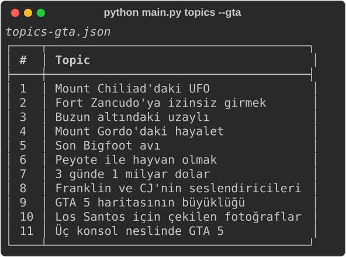

**English** | [Türkçe](README.tr.md)

# YouTube AI Automation

A YouTube Shorts automation tool for the command line, written in Python: it uses AI to turn a topic into a finished video. Gemini writes the script, Edge TTS reads it, the captions highlight each spoken word, and the video is rendered and uploaded to YouTube. It includes a Turkish GTA 5 Shorts pack that writes only from checked facts and plays over your own gameplay recordings.

## Features

- **Script from a topic:** `generate` asks Gemini's free tier for the narration, title and tags, and moves on to the next model in the list when one is busy or out of quota. A local Ollama model works too. Resolution, voice, caption style and every other structural field are filled in by code, and the file is checked against the scenario schema before it is written.
- **Turkish GTA 5 Shorts:** 11 facts, each checked against at least two sources. Gemini may only reword the fact it is given. Code checks the scene and word counts, rejects hype words and any number the fact does not contain, and sends a failing reply back with the problem written out.
- **Narration sets the timing:** Edge TTS returns the audio and the time of every word in one request. Scene length, caption timing and the word highlight all come from that measurement, and the silence left after the last word is trimmed.
- **Word-highlight captions:** Shorts show a few words at a time in capital letters and color the word being spoken. Uppercasing follows Turkish rules, so i becomes İ.
- **Footage:** stock clips from Pexels with Pixabay as a fallback, photos for long stories, or long gameplay recordings of your own. From a recording, every video gets a stretch that no earlier video used, cropped to 9:16 with the game sound muted.
- **Four formats:** vertical Shorts, 15-minute photo stories, 11-minute English stick-figure explainers drawn by the bundled Zenn renderer, and GTA Shorts.
- **Daily production:** `daily` makes at most one video a day, from a scenario you dropped into the inbox or from the next unused topic. `schedule` registers a Windows task that also runs after a day the computer was off, and still makes one video, not one per missed day.
- **YouTube upload:** resumable upload with thumbnail, playlist and SRT captions. Stock footage authors and a notice that the narration is synthetic are added to the description. Videos are uploaded as private by default, and a public upload asks for confirmation.
- **Caching:** narration, downloads and rendered scenes are stored by content, so editing one sentence re-renders one scene.
- **Safety checks:** keys are masked in logs and manifests, downloads are checked for type and size, images are decoded only as JPEG, PNG or WebP, fonts are checked against pinned SHA-256 hashes, and `clean` asks before deleting and refuses folders such as the project root or your home folder.

## Screenshots

| Word-highlight captions | GTA fact list |
| --- | --- |
|  |  |

The clip is cut from a real render of the Fort Zancudo script. The background is a generated gradient standing in for gameplay footage, which this repository does not include.

## Tech Stack

- **Language and command line:** Python, Typer, Rich
- **Data and settings:** Pydantic, pydantic-settings
- **Script writing:** Gemini API, Ollama
- **Voice:** Edge TTS
- **Video:** MoviePy, FFmpeg, libass, Pillow
- **Footage:** Pexels API, Pixabay API
- **Publishing:** YouTube Data API, Google OAuth
- **Scheduling:** Windows Task Scheduler
- **Quality:** pytest, requests-mock, ruff, mypy

## Installation

### Requirements

- Python 3.10 or newer
- About 2 GB of free disk space for the virtual environment, caches and renders
- Internet access for script writing, narration and stock footage. Rendering runs on your own machine.

FFmpeg comes with the `imageio-ffmpeg` package, so nothing has to be installed system-wide. The Inter and Anton fonts are already in `assets/fonts`.

### Setup

```bash
git clone https://github.com/MrcDprm/youtube-ai-automation.git
cd youtube-ai-automation
python -m venv .venv
# Windows PowerShell
.venv\Scripts\Activate.ps1
# macOS and Linux
source .venv/bin/activate
pip install -r requirements.txt
cp .env.example .env
python main.py doctor
```

`doctor` checks Python, FFmpeg, Edge TTS, the keys, fonts, folders and free disk space, and prints a hint next to anything that is missing.

### Keys

Keys go in `.env`. Git ignores that file, and the keys are masked in every log.

- `GEMINI_API_KEY`: a free key from [Google AI Studio](https://aistudio.google.com/apikey). On the free tier Google may use prompts and answers to improve its products, and people may read them during review, so keep private information out of topics and guidance. Checking facts with Google Search needs the paid tier for new keys, which is why `GEMINI_GROUNDING` is `false`. To write scripts on your own machine instead, install [Ollama](https://ollama.com), run `ollama pull qwen2.5:7b-instruct` and set `SCRIPT_PROVIDER=ollama`.
- `PEXELS_API_KEY`: a free key from [pexels.com/api](https://www.pexels.com/api/), with 200 requests an hour and 20,000 a month. `PIXABAY_API_KEY` is an optional fallback. GTA Shorts need neither.

### First video

```bash
python main.py generate "Kahvenin dünyaya yayılışı" --scenes 8
python main.py validate
python main.py run --dry-run
python main.py run
```

`generate` only writes `senaryo.json`. Read it and fix anything you disagree with, then render. `run --dry-run` prints the plan without touching the network. The video and a manifest with timings and media credits are written to `output/final`, and the thumbnail to `output/thumbnails`.

`--format story` writes a 15-minute landscape photo story, `--format paint` an 11-minute English stick-figure explainer, and `--language en` narrates in English. `senaryo.example.json` is a starting point for writing a scenario by hand, and `models/scenario.py` describes every field. Unknown fields are rejected, so a typo fails instead of being ignored.

### GTA 5 Shorts

1. Put long gameplay recordings of your own into `assets/background/gta5`, or point `GTA_BACKGROUND_DIR` in `.env` at another folder. Ten minutes or more per file is enough for many Shorts. Leave out menus, loading screens and cutscenes.
2. List the facts, write a script from one and render it:

   ```bash
   python main.py topics --gta
   python main.py generate --format gta 3
   python main.py run
   ```

3. For a fact you checked yourself, give it with the topic: `python main.py generate --format gta "Topic" --fact "The fact"`.

A script has 3 to 8 scenes and 45 to 75 words, the title contains GTA, and every number in it must appear in the fact. The narrator is `tr-TR-AhmetNeural` at 10 percent faster speed. The game sound is muted because the in-game radio plays licensed songs. Set `VIDEO_FORMAT=gta` in `.env` to make `daily` use the GTA facts. [scenarios/README.md](scenarios/README.md) explains how to add a fact.

### Daily production

```bash
python main.py daily --dry-run
python main.py daily --yes
python main.py schedule --at 09:00
python main.py schedule --status
python main.py schedule --remove
```

`daily` makes at most one video a day. A scenario dropped into `scenarios/inbox` goes first. Otherwise the next unused topic in `scenarios/topics.json` is written and rendered, and a failed run leaves the topic for the next day. A lock file stops two runs from overlapping. Uploading stays off until you pass `--upload` or set `DAILY_UPLOAD=true`. `schedule` uses Windows Task Scheduler. On macOS or Linux, run `python main.py daily --yes` from cron.

### YouTube uploads

Uploading is optional. Skip this part if you only want MP4 files.

1. Create a project in the [Google Cloud Console](https://console.cloud.google.com/) and enable **YouTube Data API v3**.
2. On the **OAuth consent screen**, choose **External**, enter an app name and your email, and add your Google account as a test user.
3. Under **Credentials**, create an **OAuth client ID** of type **Desktop app**, download the JSON and save it as `secrets/client_secrets.json`.
4. Run `python main.py auth` and approve the request in the browser. The token is saved to `secrets/token.json` and refreshed on later runs.
5. Set `upload_enabled` to `true` in the scenario, or pass `--upload` to `daily`.

Before relying on uploads:

- **Private lock:** videos uploaded through the API from a project created after 28 July 2020 stay private until the project passes Google's compliance audit, whatever privacy you ask for. The uploader warns when this happens. Publish or schedule those videos in YouTube Studio, or apply for the audit.
- **Quota:** a project may upload 100 videos a day. Thumbnails, playlist entries and caption tracks share 10,000 units a day. Both reset at midnight Pacific time.
- **Token expiry:** while the consent screen is in Testing status, Google expires the token after seven days and `auth` has to be run again. Publishing the consent screen stops this.
- **Description:** stock footage authors and the synthetic narration notice are added automatically. Set `made_for_kids` truthfully, because it is a legal declaration.

### Commands

| Command | What it does |
| --- | --- |
| `doctor` | Checks the environment and prints a hint for anything missing |
| `generate TOPIC` | Writes a scenario with Gemini or Ollama and renders nothing |
| `topics` | Lists the daily topic bank, or the GTA facts with `--gta` |
| `validate` | Checks a scenario and prints the plan |
| `run` | Renders a scenario. `--dry-run`, `--scene-limit 2`, `--no-upload`, `--force` and `--keep-temp` change how |
| `voices --locale tr-TR` | Lists Edge TTS voices |
| `auth` | Connects a YouTube channel once |
| `daily` | Makes at most one video today |
| `schedule` | Registers, shows or removes the daily Windows task |
| `clean` | Deletes caches or output after asking, `--yes` skips the question |

Exit codes name the failure: 1 configuration, 2 scenario, 3 narration, 4 stock footage, 5 rendering, 6 upload.

### Tests

```bash
pip install -r requirements-dev.txt
pytest -q
ruff check .
mypy .
```

`make check` runs all three. The tests need no network and no keys. HTTP is stubbed with requests-mock, and narration, rendering, uploading and script writing run against fakes. One test reads `modules/pipeline.py` and fails if the pipeline imports a concrete class instead of an interface from `modules/interfaces.py`.

## What I Learned

- **Narration is the clock.** Edge TTS sends a word boundary event for every word along with the audio, so one request gives me the sound and the time of each word. I cut every scene to the measured audio and drive the captions and the highlight from those times instead of guessing from character counts. The same data showed me the silence Edge TTS leaves after the last word, which I now trim.
- **Rules belong in code, not only in the prompt.** Gemini writes fluent Turkish but adds details that are not true and sometimes drops Turkish letters. I give it only facts I checked against two sources and check every reply in code: scene and word counts, hype words, numbers missing from the fact, Turkish letters and apostrophes. A reply that breaks a rule goes back with the exact problem, so the rules hold even when the model ignores the prompt.
- **Turkish needs its own handling.** Python's `str.upper` turns i into I, so the captions were wrong until I mapped i to İ and ı to I. Turkish Windows also prints `schtasks` output in the OEM code page, which broke `schedule --remove` until I decoded it that way.
- **FFmpeg filters are escaped twice.** A folder name with an apostrophe broke the subtitle filter. The path has to be escaped once as a filter option and once more inside the filter graph.
- **Interfaces make the pipeline testable.** The pipeline only knows seven interfaces, and `main.py` is the only place that picks real classes. I could test the whole flow offline with fakes, and an AST test keeps it that way.
- **Free tiers come with rules.** Gemini's free tier may use prompts to improve Google's products, and Google Search grounding is paid for new keys. YouTube keeps uploads from unaudited API projects private, counts uploads in their own quota, and expires Testing-mode tokens after seven days. I built each of these into the code, the warnings or this README.
- **Downloaded files are untrusted input.** MoviePy keeps Pillow below version 12, and the versions it allows have known security issues, so images are decoded only as JPEG, PNG or WebP. Downloads are checked for type and size, fonts against pinned SHA-256 hashes, and keys are masked in logs because a Pixabay key travels inside the request URL.
- **Caching by content makes reruns cheap.** Narration, downloads and scenes are saved under a hash of what produced them. Changing one sentence re-renders one scene, and a run that died halfway picks up where it stopped.
