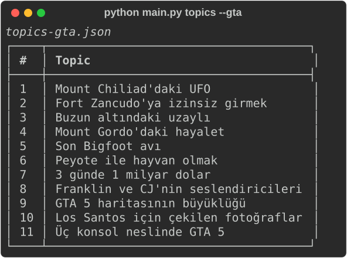

[English](README.md) | **Türkçe**

# YouTube AI Automation

Bir konuyu bitmiş bir YouTube Shorts videosuna çeviren Python komut satırı aracı: senaryoyu Gemini yazar, Edge TTS seslendirir, altyazı konuşulan her kelimeyi vurgular, video render edilip YouTube'a yüklenir. İçindeki Türkçe GTA 5 Shorts paketi yalnızca doğrulanmış bilgilerden yazar ve senin kendi oynanış kayıtlarının üzerinde oynar.

## Özellikler

- **Konudan senaryo:** `generate`, anlatımı, başlığı ve etiketleri Gemini'nin ücretsiz katmanından ister; bir model meşgulse ya da kotası dolmuşsa listedeki sonraki model yazar. Yerel bir Ollama modeli de kullanılabilir. Çözünürlük, ses, altyazı stili ve diğer bütün yapısal alanları kod doldurur, dosya yazılmadan önce senaryo şemasına göre denetlenir.
- **Türkçe GTA 5 Shorts:** Her biri en az iki kaynakla doğrulanmış 11 bilgi. Gemini yalnızca kendisine verilen bilgiyi yeniden ifade edebilir. Kod sahne ve kelime sayısını denetler, abartılı sözleri ve bilgide geçmeyen her sayıyı reddeder, kurala uymayan cevabı sorunu yazarak geri gönderir.
- **Zamanlamayı anlatım belirler:** Edge TTS tek istekte hem sesi hem her kelimenin zamanını verir. Sahne süresi, altyazı zamanı ve kelime vurgusu bu ölçümden gelir, son kelimeden sonra kalan sessizlik kırpılır.
- **Kelime vurgulu altyazı:** Shorts'ta altyazı birkaç kelimelik büyük harfli parçalar halinde görünür ve o an söylenen kelime renklenir. Büyük harfe çevirme Türkçe kurallarına uyar, i harfi İ olur.
- **Görüntü:** Pexels'ten stok video ve yedek olarak Pixabay, uzun hikayeler için fotoğraf ya da senin kendi uzun oynanış kayıtların. Kayıttan her video, daha önce hiçbir videonun kullanmadığı bir kesit alır; kesit 9:16 kırpılır ve oyun sesi kapatılır.
- **Dört biçim:** dikey Shorts, 15 dakikalık fotoğraflı hikaye, projedeki Zenn çizicisiyle hazırlanan 11 dakikalık İngilizce çöp adam anlatımı ve GTA Shorts.
- **Günlük üretim:** `daily` günde en fazla bir video üretir; önce gelen kutusuna bıraktığın senaryoyu, yoksa sıradaki kullanılmamış konuyu alır. `schedule` bir Windows görevi kaydeder. Görev bilgisayarın kapalı kaldığı bir günden sonra da çalışır ve kaçırılan her gün için değil, yalnızca bir video üretir.
- **YouTube'a yükleme:** Kapak görseli, oynatma listesi ve SRT altyazıyla, kesilirse kaldığı yerden devam eden yükleme. Stok görüntülerin sahipleri ve anlatımın yapay ses olduğunu belirten not açıklamaya eklenir. Videolar varsayılan olarak gizli yüklenir, herkese açık yükleme onay ister.
- **Önbellek:** Seslendirme, indirmeler ve render edilen sahneler içeriklerine göre saklanır; bir cümleyi değiştirmek yalnızca o sahneyi yeniden render eder.
- **Güvenlik denetimleri:** Anahtarlar log ve manifest dosyalarında maskelenir, indirmelerin türü ve boyutu denetlenir, görseller yalnızca JPEG, PNG ya da WebP olarak açılır, yazı tipleri sabit SHA-256 özetleriyle doğrulanır. `clean` silmeden önce sorar, proje kökü ya da ev klasörü gibi klasörleri silmeyi reddeder.

## Ekran Görüntüleri

| Kelime vurgulu altyazı | GTA bilgi listesi |
| --- | --- |
|  |  |

Klip, Fort Zancudo senaryosunun gerçek bir render'ından kesildi. Arka plan, oynanış görüntüsünün yerine üretilmiş bir renk geçişidir; oynanış görüntüleri bu repoda yer almaz.

## Kullanılan Teknolojiler

- **Dil ve komut satırı:** Python, Typer, Rich
- **Veri ve ayarlar:** Pydantic, pydantic-settings
- **Senaryo yazımı:** Gemini API, Ollama
- **Ses:** Edge TTS
- **Video:** MoviePy, FFmpeg, libass, Pillow
- **Görüntü kaynakları:** Pexels API, Pixabay API
- **Yayın:** YouTube Data API, Google OAuth
- **Zamanlama:** Windows Görev Zamanlayıcı
- **Kalite:** pytest, requests-mock, ruff, mypy

## Kurulum ve Çalıştırma

### Gereksinimler

- Python 3.10 ya da daha yeni bir sürüm
- Sanal ortam, önbellek ve render'lar için yaklaşık 2 GB boş alan
- Senaryo yazımı, seslendirme ve stok görüntü için internet bağlantısı. Render senin bilgisayarında çalışır.

FFmpeg, `imageio-ffmpeg` paketiyle gelir; sisteme ayrıca kurmak gerekmez. Inter ve Anton yazı tipleri `assets/fonts` klasöründe hazırdır.

### Kurulum

```bash
git clone https://github.com/MrcDprm/youtube-ai-automation.git
cd youtube-ai-automation
python -m venv .venv
# Windows PowerShell
.venv\Scripts\Activate.ps1
# macOS ve Linux
source .venv/bin/activate
pip install -r requirements.txt
cp .env.example .env
python main.py doctor
```

`doctor` komutu Python'u, FFmpeg'i, Edge TTS'i, anahtarları, yazı tiplerini, klasörleri ve boş disk alanını denetler, eksik olan her şeyin yanına bir ipucu yazar.

### Anahtarlar

Anahtarlar `.env` dosyasına yazılır. Git bu dosyayı yok sayar, anahtarlar da her logda maskelenir.

- `GEMINI_API_KEY`: [Google AI Studio](https://aistudio.google.com/apikey) üzerinden alınan ücretsiz anahtar. Ücretsiz katmanda Google istemleri ve cevapları ürünlerini geliştirmek için kullanabilir, inceleme sırasında insanlar da okuyabilir; bu yüzden konulara ve yönlendirmelere özel bilgi yazma. Google Search ile bilgi doğrulama yeni anahtarlarda ücretli katman istediği için `GEMINI_GROUNDING` değeri `false`. Senaryoyu kendi bilgisayarında yazdırmak istersen [Ollama](https://ollama.com) kur, `ollama pull qwen2.5:7b-instruct` komutunu çalıştır ve `SCRIPT_PROVIDER=ollama` yap.
- `PEXELS_API_KEY`: [pexels.com/api](https://www.pexels.com/api/) üzerinden alınan ücretsiz anahtar; saatte 200, ayda 20.000 istek hakkı verir. `PIXABAY_API_KEY` isteğe bağlı yedektir. GTA Shorts ikisine de ihtiyaç duymaz.

### İlk video

```bash
python main.py generate "Kahvenin dünyaya yayılışı" --scenes 8
python main.py validate
python main.py run --dry-run
python main.py run
```

`generate` yalnızca `senaryo.json` dosyasını yazar. Dosyayı oku, katılmadığın yeri düzelt, sonra render et. `run --dry-run` ağa hiç çıkmadan planı yazdırır. Video ile zamanlamaları ve görüntü kaynaklarını içeren manifest `output/final` klasörüne, kapak görseli `output/thumbnails` klasörüne yazılır.

`--format story` 15 dakikalık yatay bir fotoğraflı hikaye, `--format paint` 11 dakikalık İngilizce bir çöp adam anlatımı yazar; `--language en` anlatımı İngilizce yapar. Elle senaryo yazmak için `senaryo.example.json` bir başlangıç noktasıdır, bütün alanlar `models/scenario.py` dosyasında açıklanır. Bilinmeyen alanlar reddedilir, böylece bir yazım hatası yok sayılmak yerine hata verir.

### GTA 5 Shorts

1. Kendi uzun oynanış kayıtlarını `assets/background/gta5` klasörüne koy ya da `.env` içindeki `GTA_BACKGROUND_DIR` ile başka bir klasör göster. Dosya başına on dakika ya da daha uzun kayıt birçok Shorts için yeter. Menüleri, yükleme ekranlarını ve ara sahneleri kayda alma.
2. Bilgileri listele, birinden senaryo yazdır ve render et:

   ```bash
   python main.py topics --gta
   python main.py generate --format gta 3
   python main.py run
   ```

3. Kendi doğruladığın bir bilgi için bilgiyi konuyla birlikte ver: `python main.py generate --format gta "Konu" --fact "Bilgi"`.

Bir senaryo 3 ile 8 arası sahneden ve 45 ile 75 arası kelimeden oluşur, başlıkta GTA geçer ve metindeki her sayı bilgide de bulunmak zorundadır. Anlatıcı `tr-TR-AhmetNeural`, yüzde 10 hızlandırılmış. Oyun sesi kapalıdır, çünkü oyun içi radyo lisanslı şarkılar çalar. `daily` komutunun GTA bilgilerini kullanması için `.env` içinde `VIDEO_FORMAT=gta` yap. Yeni bilgi eklemenin kuralları [scenarios/README.md](scenarios/README.md) dosyasında.

### Günlük üretim

```bash
python main.py daily --dry-run
python main.py daily --yes
python main.py schedule --at 09:00
python main.py schedule --status
python main.py schedule --remove
```

`daily` günde en fazla bir video üretir. Önce `scenarios/inbox` klasörüne bırakılan senaryo alınır. Yoksa `scenarios/topics.json` içindeki sıradaki kullanılmamış konu yazılıp render edilir; başarısız bir çalışma konuyu ertesi güne bırakır. Bir kilit dosyası iki çalışmanın üst üste binmesini önler. `--upload` verilene ya da `DAILY_UPLOAD=true` yapılana kadar yükleme kapalıdır. `schedule` Windows Görev Zamanlayıcı'yı kullanır. macOS ve Linux'ta `python main.py daily --yes` komutunu cron ile çalıştır.

### YouTube'a yükleme

Yükleme isteğe bağlıdır. Yalnızca MP4 dosyası istiyorsan bu bölümü atla.

1. [Google Cloud Console](https://console.cloud.google.com/) üzerinde bir proje oluştur ve **YouTube Data API v3** hizmetini etkinleştir.
2. **OAuth consent screen** ekranında **External** seç, uygulama adını ve e-postanı gir, Google hesabını test kullanıcısı olarak ekle.
3. **Credentials** altında **Desktop app** türünde bir **OAuth client ID** oluştur, JSON dosyasını indir ve `secrets/client_secrets.json` olarak kaydet.
4. `python main.py auth` komutunu çalıştır ve tarayıcıda izni onayla. Token `secrets/token.json` dosyasına kaydedilir ve sonraki çalışmalarda yenilenir.
5. Senaryoda `upload_enabled` değerini `true` yap ya da `daily` komutuna `--upload` ver.

Yüklemeye güvenmeden önce:

- **Gizli kilit:** 28 Temmuz 2020'den sonra oluşturulmuş bir projeden API ile yüklenen videolar, proje Google'ın uyumluluk denetiminden geçene kadar hangi gizlilik seçilirse seçilsin gizli kalır. Bu olduğunda yükleyici uyarır. Bu videoları YouTube Studio'dan yayınla ya da zamanla, istersen denetime başvur.
- **Kota:** Bir proje günde 100 video yükleyebilir. Kapak görseli, oynatma listesi ve altyazı istekleri günde 10.000 birimi paylaşır. İkisi de Pasifik saatiyle gece yarısı sıfırlanır.
- **Token süresi:** İzin ekranı Testing durumundayken Google token'ı yedi günde geçersiz kılar ve `auth` komutunun yeniden çalıştırılması gerekir. İzin ekranını yayınlamak bunu durdurur.
- **Açıklama:** Stok görüntülerin sahipleri ve yapay ses notu otomatik eklenir. `made_for_kids` yasal bir beyan olduğu için doğru ayarlanmalıdır.

### Komutlar

| Komut | Ne yapar |
| --- | --- |
| `doctor` | Ortamı denetler, eksik olan her şey için ipucu yazar |
| `generate KONU` | Gemini ya da Ollama ile senaryo yazar, render etmez |
| `topics` | Günlük konu listesini, `--gta` ile GTA bilgilerini listeler |
| `validate` | Senaryoyu denetler ve planı yazdırır |
| `run` | Senaryoyu render eder. `--dry-run`, `--scene-limit 2`, `--no-upload`, `--force` ve `--keep-temp` çalışma biçimini değiştirir |
| `voices --locale tr-TR` | Edge TTS seslerini listeler |
| `auth` | YouTube kanalını bir kez bağlar |
| `daily` | Bugün için en fazla bir video üretir |
| `schedule` | Günlük Windows görevini kaydeder, gösterir ya da kaldırır |
| `clean` | Önbelleği ya da çıktıları sorarak siler, `--yes` soruyu atlar |

Çıkış kodları hatanın nerede olduğunu söyler: 1 ayar, 2 senaryo, 3 seslendirme, 4 stok görüntü, 5 render, 6 yükleme.

### Testler

```bash
pip install -r requirements-dev.txt
pytest -q
ruff check .
mypy .
```

`make check` üçünü birden çalıştırır. Testler ağ ve anahtar istemez. HTTP istekleri requests-mock ile taklit edilir; seslendirme, render, yükleme ve senaryo yazımı sahte sınıflarla çalışır. Bir test `modules/pipeline.py` dosyasını okur ve pipeline, `modules/interfaces.py` içindeki bir arayüz yerine somut bir sınıfı import ederse başarısız olur.

## Öğrendiklerim

- **Zamanlamayı anlatım belirliyor.** Edge TTS sesle birlikte her kelime için bir word boundary olayı gönderiyor, böylece tek istekle hem sesi hem her kelimenin zamanını alıyorum. Her sahneyi ölçülen sese göre kesiyor, altyazıyı ve vurguyu karakter sayısından tahmin etmek yerine bu zamanlardan üretiyorum. Aynı veri Edge TTS'in son kelimeden sonra bıraktığı sessizliği de gösterdi; artık onu kırpıyorum.
- **Kurallar yalnızca istemde değil, kodda da olmalı.** Gemini akıcı Türkçe yazıyor ama doğru olmayan ayrıntılar ekliyor ve bazen Türkçe harfleri atlıyor. Ona yalnızca iki kaynakla doğruladığım bilgileri veriyor, her cevabı kodda denetliyorum: sahne ve kelime sayısı, abartılı sözler, bilgide olmayan sayılar, Türkçe harfler ve kesme işaretleri. Kurala uymayan cevap sorunun tam tarifiyle geri gidiyor, böylece model istemi dinlemese bile kurallar korunuyor.
- **Türkçe kendine özgü işlem istiyor.** Python'un `str.upper` fonksiyonu i harfini I yapıyor; i'yi İ'ye, ı'yı I'ya eşleyene kadar altyazılar yanlıştı. Türkçe Windows da `schtasks` çıktısını OEM kod sayfasında yazıyor; çıktıyı bu kod sayfasıyla okuyana kadar `schedule --remove` hata verdi.
- **FFmpeg filtrelerinde kaçış iki katmanlı.** Kesme işaretli bir klasör adı altyazı filtresini bozdu. Yolun bir kez filtre seçeneği, bir kez de filtre grafiği için kaçışlanması gerekiyor.
- **Arayüzler pipeline'ı test edilebilir yapıyor.** Pipeline yalnızca altı arayüzü biliyor, gerçek sınıfları seçen tek yer `main.py`. Bütün akışı sahte sınıflarla ağ olmadan test edebildim, bir AST testi de bu düzeni koruyor.
- **Ücretsiz katmanların kuralları var.** Gemini'nin ücretsiz katmanı istemleri Google ürünlerini geliştirmek için kullanabiliyor, Google Search doğrulaması yeni anahtarlarda ücretli. YouTube, denetimden geçmemiş API projelerinden yüklenen videoları gizli tutuyor, yüklemeleri ayrı bir kotayla sayıyor ve Testing durumundaki token'ları yedi günde geçersiz kılıyor. Bunların her birini koda, uyarılara ya da bu README'ye işledim.
- **İndirilen dosyalar güvenilmeyen girdidir.** MoviePy, Pillow'u 12 sürümünün altında tutuyor ve izin verdiği sürümlerde bilinen güvenlik açıkları var; bu yüzden görseller yalnızca JPEG, PNG ya da WebP olarak açılıyor. İndirmelerin türü ve boyutu denetleniyor, yazı tipleri sabit SHA-256 özetleriyle doğrulanıyor. Pixabay anahtarı istek adresinin içinde gittiği için anahtarlar loglarda maskeleniyor.
- **İçeriğe göre önbellek tekrar çalıştırmayı ucuzlatıyor.** Seslendirme, indirmeler ve sahneler, onları üreten verinin özetiyle saklanıyor. Bir cümleyi değiştirmek tek bir sahneyi yeniden render ediyor, yarıda kalan bir çalışma kaldığı yerden devam ediyor.
